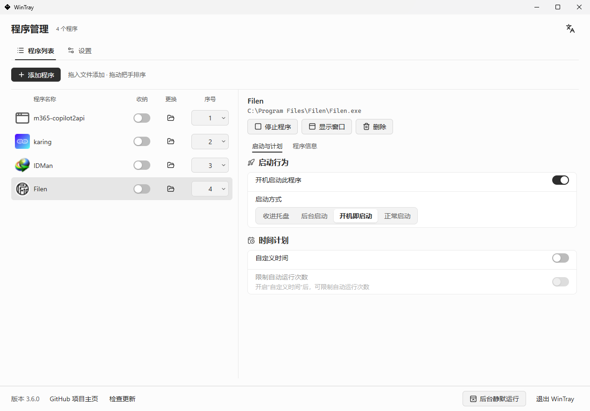
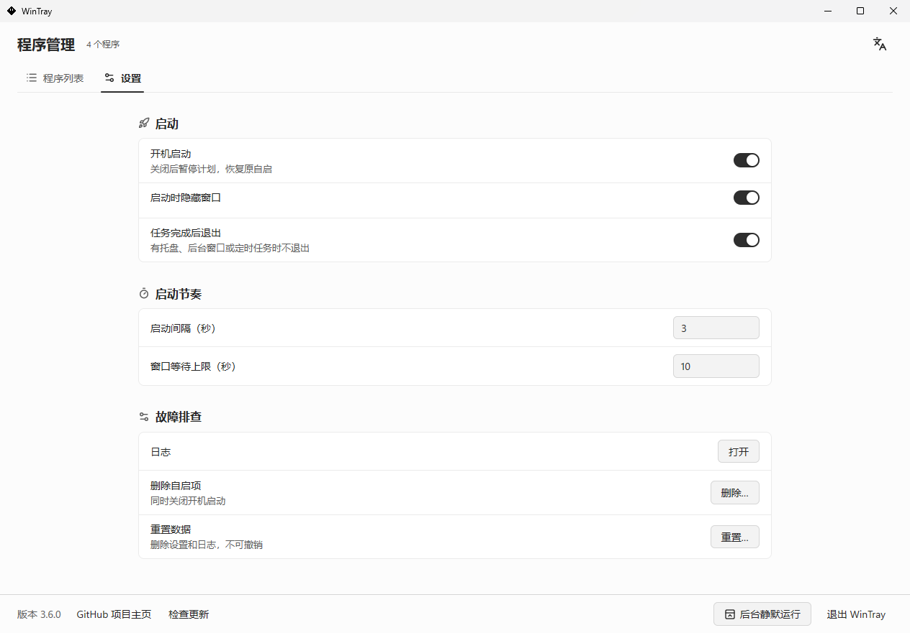

# WinTray

**A Windows tool for startup window management and background launches**

English | [简体中文](README.md)

WinTray starts programs, closes their windows, or runs background scripts when you sign in to Windows. In this guide, startup means startup after Windows sign-in.

## Download and use

Download one of these files from [Releases](../../releases).

| Version | File | How to open |
| --- | --- | --- |
| Installed | `WinTray-Setup.exe` | Run the installer, then open WinTray from the Start menu |
| Portable | `WinTray-Portable.zip` | Extract the complete archive, then run `WinTray.exe` |

1. In **Programs**, select **Add Program** to add files, or **Installed apps** to select apps installed on the computer.
2. Select a program.
3. In **Startup & schedule**, select a mode under **How it starts**.
4. For automatic launches through WinTray, turn on **Start at sign-in** in **Settings**.
5. Use **Launch Now** to check the launch behavior. Check automatic startup at the next Windows sign-in.

Changes save automatically. For names, arguments, working directories, and numbers, press `Enter` or leave the field to save.

## Program management

| Action | Method |
| --- | --- |
| Edit the name, arguments, or working directory | Select the program, then open **Program details** |
| Change the program file | Select the program, then drag one file onto the **Open file location** icon |
| Change the start order | Drag the icon on the left of the program row, or select an **Order** number. Press `Esc` to cancel a drag |
| Stop a program | Select the running program, then select **Stop Program** |
| Show or hide a window | Select the running program, then select **Show Window** or **Hide Window** |
| Open the program folder | Select the **Open file location** folder icon before the file path in the details pane |
| Remove a program | Select the program, select **Delete**, then select **Confirm**. The program file is kept |

Drag the divider between the list and details to change their widths. In a narrow window, the list appears above the details.

## Add programs and apps

| Type | Requirement |
| --- | --- |
| `.exe` | Select the file that displays the main window, not an updater |
| `.bat` / `.cmd` | Windows `cmd.exe` |
| `.ps1` | Windows PowerShell |
| `.py` / `.pyw` | `python.exe` / `pythonw.exe` available through `PATH` |
| `.ahk` | Install AutoHotkey and check that double-clicking the script runs it |
| Store apps (MSIX/UWP) | Use **Installed apps** to select an app installed for the current Windows user |

In **Installed apps**, search by name or path and filter by **Desktop apps** or **Store apps**. Check the apps, then select **Add selected apps**. The list contains launchable entries from the Windows app list. For other programs, select a file with **Add Program**, or drag it into the list.

Store apps must support the arguments you enter. Windows sets their working directory.

Scripts support **Start normally** and **Run in background**. Install the script dependencies first. If WinTray runs as administrator, use **Add Program** to select files.

## Launch modes

Select a mode in **Startup & schedule**.

| Mode | Behavior |
| --- | --- |
| Start normally (default) | Keeps the program's own sign-in startup settings |
| Close to tray | Closes the window after launch. Graphical programs must support closing to the tray, or they can exit |
| Run in background | Hides the console window; hides Store app windows after launch. Graphical windows created by other programs can still appear |
| Launch at boot | Uses a scheduled task at sign-in. Supports EXE files and Store apps. Desktop programs keep the original startup arguments, privileges, and delay when available |

For desktop programs, WinTray uses the arguments and working directory in **Program details** when it starts the program directly or creates a new sign-in task. Enter a working directory or choose a folder. Leave it blank to use the program folder. Relative paths start from that folder. An original startup entry supplies its own arguments and working directory.

**Launch Now** uses the selected launch mode.

Existing settings remain usable. On upgrade, paused programs without **Custom timing** switch to **Start normally**.

### Close to tray

**Wait before closing (sec)** accepts 0–600 seconds. The default is 0. The wait starts when the target process is created. A value of 0 closes the window immediately.

- For QQ, enable **Close after login**. It is off by default and only applies to **Close to tray**. WinTray keeps the login window open, then retries closing the recognized main window to tray. No wait time is required, and WinTray does not click Log in.
- Other programs continue to use the wait time. For programs that require login, set the wait longer than the login process or select **Start normally**.
- If the program disables **Close** and does not respond to `Esc`, the window stays open. A window can briefly appear or take focus during startup.
- For console programs such as `syncthing.exe` and `frpc.exe`, WinTray provides a tray icon. Left-click it to show or hide the window. Use its right-click menu to quit the program.
- For Store apps, WinTray hides the window and provides a tray icon. Use **Show Window** to restore the app.

### Background windows

Use **Show Window** to read console output and enter commands. Closing the console window can end the program. Output is not retained after the program exits.

For `.pyw`, only a graphical window created by the script can be shown. Exit and relaunch programs started in the background by an older WinTray. Previously discarded output cannot be recovered.

### Launch at boot

For desktop programs, WinTray reuses an available scheduled task at sign-in. The task keeps its original privileges and delay.

For a supported current-user registry entry or Startup-folder shortcut, WinTray temporarily disables the original entry to prevent duplicate launches. If no original entry exists, WinTray creates a task from the current settings. Windows requests confirmation when administrator privileges are required.

New tasks start when WinTray and the desktop are ready. If a launch delay is set, new tasks use that delay.

Store apps use the arguments in **Program details**. Their own startup settings stay unchanged.

WinTray restores original startup when you disable this mode without a launch limit, remove the program, or disable WinTray startup.

### WeChat auto login

Select `Weixin.exe` or `WeChat.exe` to use **WeChat auto login**. It is off by default and unavailable in **Run in background** mode.

WinTray clicks the login button. Scan the QR code or confirm on your phone when required. With **Close to tray**, WinTray keeps waiting for the main window and retries closing it to tray. No wait time is required. Other startup modes wait up to 30 seconds for login.

If the QQ or WeChat main window cannot be recognized, it stays open. Waiting stops after successful closing, program exit, or WinTray exit. Windows you reopen afterward stay open. The program must support closing to its tray.

## Timing

In **Startup & schedule**, turn on **Custom timing**.

| Setting | Range | Default |
| --- | --- | --- |
| Launch delay (min) | 0–1440 minutes from Windows sign-in | 0; start immediately |
| Automatic exit (min) | 0–1440 minutes from process creation | 30; set to 0 to disable automatic exit |
| Limit automatic launches | 1–1000 launches in the last 1–365 calendar days | Off; 1 launch in 1 day when enabled |

Automatic startup requires WinTray's **Start at sign-in** setting. **Custom timing** starts the program even in **Start normally** mode. Turn off **Custom timing** to disable all three settings in the table.

Automatic exit ends the program and its child processes. It also applies to manually started programs. Save your work before the time limit.

The launch limit applies only to automatic startup. **Launch Now** and manual launches are not limited. Days use the computer's time zone and include today. One day starts at today's midnight. Restarting does not clear the history.

When the limit is enabled, WinTray takes over the `.exe` program's original startup and checks the count before launch. When the limit is disabled, WinTray restores startup for the current launch mode. Scripts can use the limit, but WinTray cannot take over a script's external startup. A Store app's own sign-in startup is not limited by WinTray.

## Tray collection

Turn on **Tray** in the program list to move the program's existing tray icons into the WinTray menu. This requires Windows 11 and supports EXE files and Store apps.

- In the WinTray tray menu, click a program icon to open its window. Right-click its row to open the program's own tray menu.
- Turn off **Tray**, or exit WinTray normally, to restore the original icons.
- If WinTray is force-closed, it restores the original icons of programs that are still running.

## Settings

| Group | Purpose |
| --- | --- |
| Sign-in | Set WinTray startup, hide its main window at sign-in, or exit after sign-in tasks finish |
| Timing | **Launch interval (seconds)**: default 3, range 0–120. **Window wait limit (seconds)**: default 10, range 0–120 |
| Troubleshooting | Open logs, remove the WinTray sign-in task, or reset all data |

The launch interval applies only to programs that WinTray starts automatically. A value of 0 means no wait. It does not apply to **Launch at boot**, original startup entries, or **Launch Now**.

WinTray keeps running while tray collection, background windows, or console tray icons are in use. It also stays running while a program waits for automatic exit.

Select **Run silently** to hide the main window. WinTray keeps its own tray icon when tray collection or background windows are in use. Otherwise, it hides that icon. Run `WinTray.exe` again to open the main window.

**Exit WinTray** attempts to restore hidden windows and waits up to 2 seconds. You may need to restart a program whose window cannot be restored.

## User data

For the same Windows user, the installed and portable versions share `%LOCALAPPDATA%\WinTray`. Both read the existing settings without migration.

| Data | File |
| --- | --- |
| Configuration | `%LOCALAPPDATA%\WinTray\settings.json` |
| Startup recovery backup | `%LOCALAPPDATA%\WinTray\startup-migrations.json` |
| Log | `%LOCALAPPDATA%\WinTray\wintray.log` |

The installer puts program files in `%LOCALAPPDATA%\Programs\WinTray` by default. Uninstalling keeps user data.

## Update and uninstall

Before updating, select **Exit WinTray**. For the installed version, run the new installer. For the portable version, extract the complete new archive into the existing program folder and replace the files.

| Action | Steps |
| --- | --- |
| Stop WinTray startup | In **Settings**, turn off **Start at sign-in**. Original program startup is kept or restored |
| Uninstall the installed version | Exit WinTray, then run **Uninstall** from the WinTray folder in the Start menu. Uninstalling restores original startup |
| Delete the portable version | Disable WinTray startup, exit WinTray, then move the program folder to the Recycle Bin |
| Clear user data | In **Settings → Troubleshooting**, select **Reset…**. Confirm, then wait for WinTray to exit. This clears settings and logs |

If original startup cannot be restored, follow the error message and retry. Keep the startup recovery backup until restoration succeeds.

## Troubleshooting

- **Main window is missing**: Left-click the WinTray tray icon, or run `WinTray.exe` again.
- **Program is not closed to the tray**: Enable WinTray startup and select **Close to tray** for the program. If the window appears slowly, increase **Window wait limit (seconds)**.
- **QQ cannot sign in or exits**: Increase **Wait before closing (sec)**, or use **Start normally**.
- **Problem continues**: In **Settings → Troubleshooting**, select **Open Logs**.

When WinTray detects original startup, it waits for Windows to start the program. It does not launch another instance after a timeout or when the program is already running. Detection covers registry `Run` entries, Startup-folder shortcuts, and supported scheduled tasks at sign-in.

## System requirements

| Use | Requirement |
| --- | --- |
| Run WinTray | Windows 10 / 11; no additional runtime. Tray collection requires Windows 11 |
| Run scripts | The required interpreter and script dependencies |
| Build and package | Windows, Go 1.27.3 or later, Visual Studio C++ Build Tools (x86/x64 tools and Windows SDK), and NSIS 3 |

## License

[MIT License](LICENSE)
