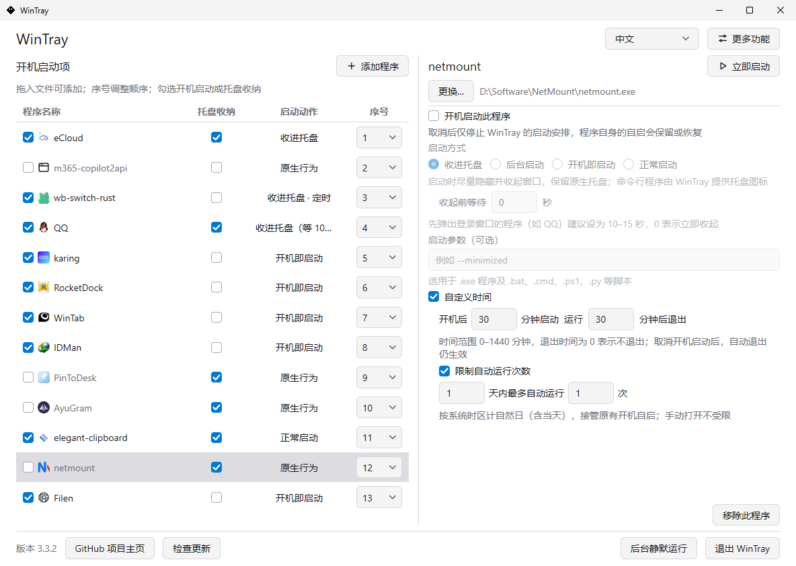
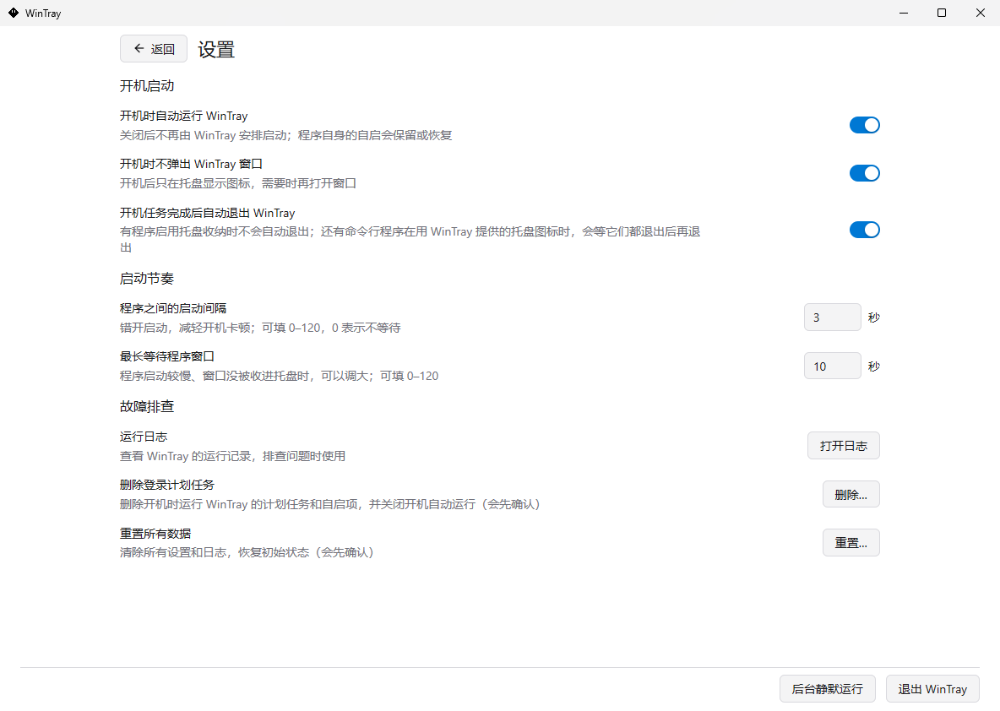

# WinTray

**Windows 开机窗口整理与后台启动工具**

[English](README.en.md) | 简体中文

## 简介

WinTray 在登录 Windows 后启动指定程序，并按设置收起窗口或在后台运行脚本。本文中的“开机启动”指登录 Windows 后启动。

- **收进托盘**：收起程序窗口。支持关闭到托盘的程序继续运行；命令行程序由 WinTray 提供托盘图标。
- **后台启动**：启动脚本或命令行工具时不显示控制台窗口。
- **托盘收纳**：把选定程序的托盘图标移入 WinTray 菜单。此功能需要 Windows 11。
- **收纳图标自动恢复**：WinTray 被强制结束后，自动还原仍在运行程序的原图标。
- **开机即启动**：通过登录计划任务启动程序，优先沿用原自启参数和权限。
- **自定义时间**：设置延后启动、自动退出和自动运行次数限制。
- **收起前等待**：让程序运行指定秒数后再收起窗口。

## 下载与使用

WinTray 仅提供便携版，无需安装。

1. 从 [Releases](../../releases) 下载最新的 `WinTray-Portable.zip`。
2. 将压缩包解压到准备长期使用的文件夹。
3. 运行 `WinTray.exe`。
4. 选择“添加程序”，或从资源管理器将程序或脚本拖入左侧程序列表，可一次添加多个。
5. 为程序选择“启动方式”，脚本固定使用“后台启动”。
6. 确认该程序已勾选“开机启动此程序”。
7. 选择主窗口右上角的“更多功能”，进入设置页。
8. 确认已开启“开机时自动运行 WinTray”。

设置保存成功后，可用“立即启动”检查启动效果；程序已运行时，WinTray 不会再次启动它。开机启动效果需在下次登录 Windows 后检查。

配置和日志保存在用户数据目录。删除程序前，请先按[停止使用 WinTray](#停止使用-wintray)中的步骤恢复原自启。

## 支持的程序类型

| 类型 | 文件扩展名 | 添加时的默认启动方式 | 使用条件 |
| --- | --- | --- | --- |
| 可执行程序 | `.exe` | 收进托盘 | 可改用其他启动方式。普通图形程序需支持关闭窗口后继续运行 |
| 批处理脚本 | `.bat` / `.cmd` | 后台启动 | 使用 Windows 的 `cmd.exe` |
| PowerShell 脚本 | `.ps1` | 后台启动 | 使用 `powershell.exe` |
| Python 脚本 | `.py` / `.pyw` | 后台启动 | 需能通过 `PATH` 找到 `python.exe` / `pythonw.exe` |

脚本的启动方式固定为“后台启动”，不能启用“托盘收纳”；所需解释器和依赖包需自行安装。

拖放仅支持上表中的文件类型。以管理员身份运行 WinTray 时，请改用“添加程序”，或以普通权限运行 WinTray 后拖入文件。

如果软件包含多个 `.exe`，请选择显示主窗口的文件。启动器或更新器可能无法匹配主窗口。

## 每个程序的独立配置

### 启动方式

勾选“开机启动此程序”后，可编辑启动方式和启动参数。

| 启动方式 | 行为与适用条件 |
| --- | --- |
| 收进托盘 | 启动后收起窗口。适合支持关闭到托盘的程序，以及需要托盘入口的命令行程序 |
| 后台启动 | 启动时不显示控制台窗口。适合脚本和命令行工具；程序自行创建的图形窗口仍可能显示 |
| 开机即启动 | 使用登录计划任务，保留可识别的原自启设置。仅支持 `.exe` |
| 正常启动 | 优先沿用程序原有自启；没有原自启时由 WinTray 启动。窗口保持原样 |

**启动参数**可选。WinTray 直接启动程序时使用这些参数；沿用原自启入口时使用原入口的参数。

取消“开机启动此程序”后，WinTray 停止为该程序安排启动，程序原有自启保留或恢复。“立即启动”按正常方式启动程序；“自定义时间”仍可编辑。

### 收进托盘与收起前等待

WinTray 在“收起前等待”到期后收起程序窗口。通过程序的托盘图标可重新打开窗口。

- **范围**：0–600 秒，默认 0 秒。0 表示立即收起。
- **计时起点**：目标进程的创建时间。程序由自身自启启动时也按此时间计时。
- **登录窗口**：WinTray 不检测登录是否完成。请把等待时间设得长于实际登录过程；需要手动登录时，可改用“正常启动”。
- **窗口限制**：启动时可能短暂显示窗口或切换焦点。已固定的任务栏快捷方式仍会保留。不支持关闭到托盘的图形程序可能退出。

`syncthing.exe`、`frpc.exe` 等命令行程序选择“收进托盘”后，由 WinTray 提供托盘图标。左键单击可显示或隐藏窗口。右键菜单可显示窗口、隐藏窗口、结束托管并显示窗口，或退出程序。

### 托盘收纳

在程序列表勾选“托盘收纳”，可把该程序已有的托盘图标移入 WinTray 的右键菜单。此功能需要 Windows 11，且仅支持 `.exe`。

- 收纳后，原图标不再显示在系统托盘及其 `^` 弹出区。
- 单击 WinTray 菜单中的程序图标可打开程序窗口。
- 右键单击程序图标可打开程序自己的托盘菜单。
- 取消勾选或正常退出 WinTray，可恢复原图标。

### 开机即启动

WinTray 根据已有自启入口安排登录计划任务：

| 原自启情况 | WinTray 的处理方式 |
| --- | --- |
| 已有可用的登录计划任务 | 复用该任务，保留原参数、权限和延迟 |
| 已有可接管的当前用户注册表自启或启动文件夹快捷方式 | 沿用原启动设置，并暂时禁用原入口，避免重复启动 |
| 没有原自启入口 | 按 WinTray 中配置的程序路径和启动参数创建任务 |

新建任务在 WinTray 和桌面就绪后启动，不参与错峰间隔；设置了“自定义时间”中的延后启动时，按该延迟启动。

创建需要管理员权限的任务时，Windows 会请求确认。设置保存成功后，“立即启动”会运行同一个已注册任务，便于检查实际启动效果。

如果设置失败，请按错误提示处理后重新保存，或改用“正常启动”。

不再使用此模式且未启用次数限制时，WinTray 会删除替代任务并恢复原入口状态。取消“开机启动此程序”、移除程序或关闭 WinTray 自启，也会撤销对应的启动接管。

### 自定义时间

勾选“自定义时间”后，可设置以下项目。

| 设置 | 范围 | 默认值 | 生效条件 |
| --- | --- | --- | --- |
| 延后启动（“开机后…分钟启动”） | 0–1440 分钟 | 0 分钟 | 需开启 WinTray 自启及“开机启动此程序”；0 表示不额外延后 |
| 自动退出（“运行…分钟后退出”） | 0–1440 分钟 | 30 分钟 | WinTray 运行时生效；0 表示不自动退出 |
| 限制自动运行次数 | 最近 1–365 个自然日内最多 1–1000 次（含当天） | 默认关闭；启用时为 1 天 1 次 | 需开启 WinTray 自启及“开机启动此程序” |

延后启动从登录 Windows 时计时。未接管的原自启入口仍由 Windows 按原安排启动；直接复用的登录任务保留原延迟。

自动退出从目标进程创建时计时，到期后结束程序及其子进程。它也适用于手动启动的程序，取消“开机启动此程序”后仍可生效。

次数限制只约束开机自动运行，手动打开和“立即启动”不受限。天数按电脑系统时区的自然日计算，包含当天：1 天从当地今天 00:00 起算，2 天从昨天 00:00 起算，以此类推。

重启不会清空计次记录，升级前留下的记录也按自然日统计。延后启动和自动退出仍按经过的分钟数计算。

启用次数限制后，WinTray 接管 `.exe` 的原自启，先检查次数再启动。关闭限制后，按当前启动方式恢复启动安排。接管失败时会提示错误；需要管理员权限时会请求确认。由 WinTray 启动的脚本可以计次，但已有外部自启的脚本不支持接管计次。

取消“自定义时间”后，延后启动、自动退出和次数限制均不生效。

### 错峰启动

设置页的“程序之间的启动间隔”控制 WinTray 两次自动启动程序的最小间隔。默认 3 秒，范围为 0–120 秒；0 表示不等待。

在程序列表的“序号”下拉菜单中选择数字，可调整启动顺序。“开机即启动”、由程序原自启启动的程序，以及“立即启动”不受此间隔限制。

## 典型场景

以下场景均需开启 WinTray 自启及对应程序的“开机启动此程序”。

| 场景 | 配置方式 |
| --- | --- |
| 微信、钉钉等程序启动后收进托盘 | 添加主程序 `.exe`，选择“收进托盘”；确认程序支持关闭到托盘 |
| 新版 QQ 登录后收进托盘 | 添加 `QQ.exe`，选择“收进托盘”；将“收起前等待”设得长于实际登录过程 |
| syncthing、frpc 等命令行程序需要托盘入口 | 添加 `.exe`，选择“收进托盘” |
| 内网穿透、爬虫等脚本在后台运行 | 添加脚本，使用“后台启动”；先安装脚本所需依赖 |
| 需要管理员权限的工具通过登录任务启动 | 添加 `.exe`，选择“开机即启动”；按提示确认任务权限 |

## 常驻与退出

未勾选“开机任务完成后自动退出 WinTray”时，WinTray 保留自身托盘图标。“开机时不弹出 WinTray 窗口”决定登录后是否显示主窗口。

启用自动退出后，以下工作会使 WinTray 继续运行：

- 有程序启用“托盘收纳”。
- 仍有命令行程序使用 WinTray 提供的托盘图标。
- 仍有正在运行的程序等待自动退出。

选择设置页底部或托盘菜单中的“后台静默运行”，可隐藏主窗口。启用托盘收纳时，WinTray 保留自身托盘入口；否则隐藏自身图标。命令行程序的托盘图标仍保留。再次运行 `WinTray.exe` 可打开主窗口。

## 系统要求

| 项目 | 要求 |
| --- | --- |
| 操作系统 | Windows 10 / 11；托盘收纳需要 Windows 11 |
| WinTray 运行时 | 无需额外安装运行时 |
| 脚本运行环境 | 需具备对应解释器和脚本依赖 |
| 源码构建 | Windows、Go 1.27.1 或更高版本；打包需 Visual Studio C++ Build Tools（x86/x64 工具和 Windows SDK） |

## 数据目录

| 数据 | 路径 |
| --- | --- |
| 配置文件 | `%LOCALAPPDATA%\WinTray\settings.json` |
| 自启恢复备份 | `%LOCALAPPDATA%\WinTray\startup-migrations.json` |
| 运行日志 | `%LOCALAPPDATA%\WinTray\wintray.log` |

## 停止使用 WinTray

如果只需停止 WinTray 的开机启动，请在设置页关闭“开机时自动运行 WinTray”。WinTray 会撤销自身自启及程序的替代任务，并保留或恢复程序原有自启。

如果要删除 WinTray，请先完成以下操作。**“重置…”会清除 WinTray 的设置和日志。**

1. 在 WinTray 主窗口选择“更多功能”，进入设置页。
2. 在“故障排查”中选择“重置…”。
3. 确认重置操作。
4. 等待清理完成并退出 WinTray。
5. 将 WinTray 程序文件夹移入回收站。

如果恢复原自启失败，请按错误提示处理后重试。在恢复成功前，保留数据目录中的自启恢复备份。

## 常见问题

### 没有主窗口时，如何打开设置？

左键单击 WinTray 托盘图标。如果看不到图标，重新运行 `WinTray.exe`。

在主窗口选择“更多功能”，进入设置页。

### 新版 QQ 登录失败或直接退出，如何处理？

QQ 的登录窗口过早收到关闭请求时，可能退出。将“收起前等待”设得长于实际登录过程，再检查效果。需要手动登录时，可选择“正常启动”。

### 程序自身自启和 WinTray 同时启用，会重复启动吗？

WinTray 识别到已启用的原自启入口后，会等待 Windows 启动程序。等待超时也不会补启动，以避免重复启动。程序已经运行时，WinTray 不会再次启动它。

识别范围包括注册表 `Run` 项（含 `HKCU`、`HKLM` 和 32 位项）、启动文件夹快捷方式，以及可识别的登录计划任务。

### 程序没有被收进托盘，如何检查？

1. 确认已开启“开机时自动运行 WinTray”。
2. 确认该程序已勾选“开机启动此程序”。
3. 确认启动方式为“收进托盘”。
4. 确认所选 `.exe` 是显示主窗口的程序。
5. 如果窗口出现较慢，调大“最长等待程序窗口”。该设置默认 10 秒，范围为 0–120 秒。
6. 如果仍未生效，选择“打开日志”查看原因。

## 许可证

本项目使用 [MIT 许可证](LICENSE)。
