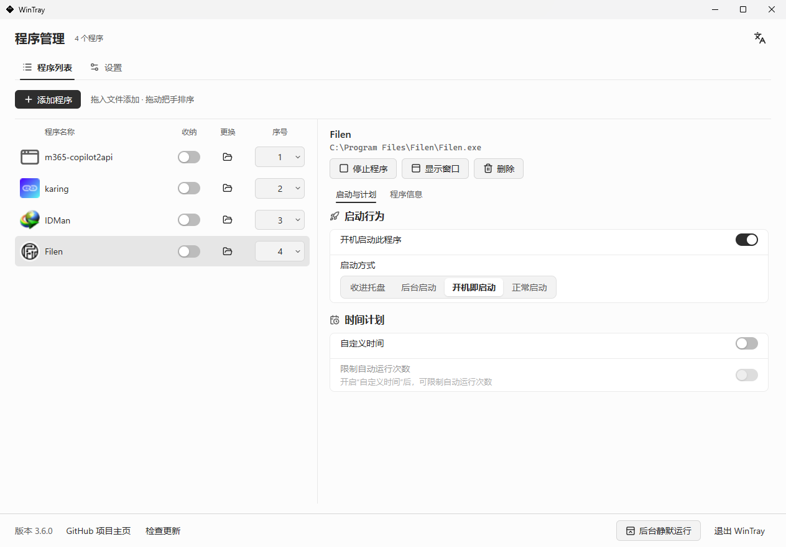
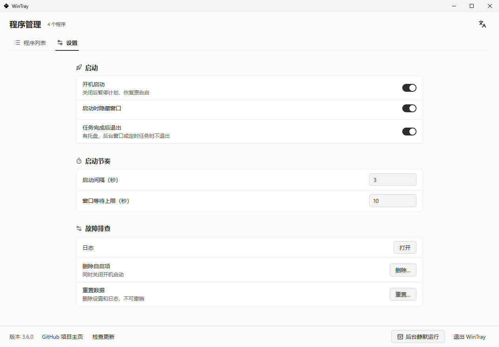

# WinTray

**Windows 开机窗口整理与后台启动工具**

[English](README.en.md) | 简体中文

WinTray 在登录 Windows 后启动程序、收起窗口或运行后台脚本。本文中的“开机启动”均指登录 Windows 后启动。

## 下载与使用

从 [Releases](../../releases) 下载以下文件之一。

| 版本 | 文件 | 打开方式 |
| --- | --- | --- |
| 安装版 | `WinTray-Setup.exe` | 运行安装器，再从开始菜单打开 WinTray |
| 便携版 | `WinTray-Portable.zip` | 解压完整压缩包，再运行 `WinTray.exe` |

1. 在“程序列表”中选择“添加程序”，或拖入程序文件。可一次添加多个。
2. 选中程序。
3. 在“启动与计划”中开启“开机启动此程序”。
4. 选择“启动方式”。
5. 在“设置”中开启“开机启动”。
6. 用“立即启动”检查启动效果。下次登录 Windows 时检查自动启动。

修改后自动保存。名称、参数、工作目录和数值在按 `Enter` 或离开输入框后保存。

## 程序管理

| 操作 | 方法 |
| --- | --- |
| 编辑名称、启动参数和工作目录 | 选中程序，打开“程序信息” |
| 更换程序文件 | 点击该行“更换”列的文件夹图标，或将一个文件拖到该图标上 |
| 调整启动顺序 | 拖动程序行左侧图标，或在“序号”中选择数字。按 `Esc` 取消拖动 |
| 停止程序 | 选中正在运行的程序，点击“停止程序” |
| 显示或隐藏窗口 | 选中正在运行的程序，点击“显示窗口”或“隐藏窗口” |
| 移除程序 | 选中程序，点击“删除”，再选择“确定”。程序文件会保留 |

拖动列表与详情之间的分隔线可调整宽度。窄窗口中，列表显示在详情上方。

## 支持的文件

| 文件 | 默认启动方式 | 要求 |
| --- | --- | --- |
| `.exe` | 收进托盘 | 选择显示主窗口的程序文件，不要选择更新器 |
| `.bat` / `.cmd` | 后台启动 | Windows `cmd.exe` |
| `.ps1` | 后台启动 | Windows PowerShell |
| `.py` / `.pyw` | 后台启动 | `PATH` 中可找到 `python.exe` / `pythonw.exe` |
| `.ahk` | 后台启动 | 安装 AutoHotkey，并确认双击脚本可运行 |

脚本固定使用“后台启动”。先安装脚本所需的依赖。以管理员身份运行 WinTray 时，使用“添加程序”选择文件。

## 启动方式

在“启动与计划”中选择启动方式。

| 方式 | 行为 |
| --- | --- |
| 收进托盘 | 启动后收起窗口。普通图形程序必须支持关闭到托盘，否则可能退出 |
| 后台启动 | 隐藏控制台窗口。适用于脚本和命令行工具；程序自行创建的图形窗口仍可能显示 |
| 开机即启动 | 通过登录计划任务启动，仅支持 `.exe`。优先沿用原自启参数、权限和延迟 |
| 正常启动 | 优先沿用程序原有自启；没有原自启时由 WinTray 启动。窗口保持原样 |

WinTray 直接启动程序或新建登录任务时，使用“程序信息”中的启动参数和工作目录。工作目录可输入或选择文件夹，留空使用程序所在目录。相对路径以程序所在目录为起点。沿用原自启入口时，使用该入口的参数和工作目录。

关闭“开机启动此程序”后，普通启动安排停止，原自启保留或恢复。“立即启动”改用正常方式；已开启的“自定义时间”仍按计划启动。

### 收进托盘

“收起前等待（秒）”范围为 0–600 秒，默认 0 秒。计时从目标进程创建时开始，0 表示立即收起。

- QQ 等程序需要登录时，将等待时间设得长于实际登录过程。需要手动登录时，可选“正常启动”。
- 程序禁用关闭且不响应 `Esc` 时，窗口保持打开。启动过程中可能短暂显示窗口或切换焦点。
- `syncthing.exe`、`frpc.exe` 等命令行程序使用此方式时，由 WinTray 提供托盘图标。左键单击可显示或隐藏窗口；右键菜单可退出程序。

### 后台窗口

用“显示窗口”查看控制台输出和输入命令。直接关闭控制台窗口可能结束程序。程序退出后，输出不再保留。

`.pyw` 只能显示脚本创建的图形窗口。旧版后台启动的程序需退出后重新启动；此前丢弃的输出不能恢复。

### 开机即启动

已有可用的登录计划任务时，WinTray 复用该任务。原任务的权限和延迟保持不变。

原入口是可接管的当前用户注册表自启或启动文件夹快捷方式时，WinTray 暂时禁用该入口，防止重复启动。没有原入口时，按当前配置创建任务。需要管理员权限时，Windows 会请求确认。

新建任务在 WinTray 和桌面就绪后启动。已设置启动延迟时，按该延迟启动。

关闭此方式且未启用次数限制、移除程序或关闭 WinTray 自启后，WinTray 会恢复原自启。关闭“开机启动此程序”且未启用“自定义时间”时，也会恢复原自启。

### 微信自动登录

选中 `Weixin.exe` 或 `WeChat.exe` 后，可开启“微信自动登录”。默认关闭，“后台启动”模式下不可用。

WinTray 自动点击登录按钮。扫码或手机确认仍需手动完成。选择“收进托盘”时，确认主窗口出现后才收起；30 秒内未确认登录成功时，保留登录窗口。

## 时间计划

在“启动与计划”中开启“自定义时间”。

| 设置 | 范围 | 默认值 |
| --- | --- | --- |
| 启动延迟（分钟） | 0–1440 分钟，从登录 Windows 时计时 | 0，立即启动 |
| 自动退出（分钟） | 0–1440 分钟，从目标进程创建时计时 | 30；设为 0 则不自动退出 |
| 限制自动运行次数 | 最近 1–365 个自然日内最多运行 1–1000 次 | 关闭；开启时为 1 天 1 次 |

自动启动需开启“开机启动”。开启“自定义时间”后，即使关闭“开机启动此程序”，也会按计划启动。关闭“自定义时间”后，上表中的三项设置均不生效。

自动退出会结束程序及其子进程，也适用于手动启动的程序。到期前保存工作。

次数限制只作用于开机自动运行。“立即启动”和手动启动不受限制。天数按电脑时区计算并包含当天；1 天从当天零点开始。重启不会清空记录。

启用次数限制后，WinTray 接管 `.exe` 的原自启，先检查次数再启动。关闭限制后，按当前启动方式恢复启动安排。脚本可使用次数限制，但不支持接管脚本的外部自启。

## 托盘收纳

在程序列表开启“收纳”，可将程序已有的托盘图标移入 WinTray 菜单。仅支持 Windows 11 和 `.exe`。

- 在 WinTray 托盘菜单中单击程序图标，可打开窗口；右键单击程序行，可打开程序自己的托盘菜单。
- 关闭“收纳”或正常退出 WinTray，可恢复原图标。
- WinTray 被强制结束后，会恢复仍在运行程序的原图标。

## 设置

| 分组 | 用途 |
| --- | --- |
| 开机启动 | 设置 WinTray 自启、登录时隐藏主窗口，以及开机任务完成后自动退出 |
| 启动节奏 | “启动间隔（秒）”默认 3，范围 0–120；“窗口等待上限（秒）”默认 10，范围 0–120 |
| 故障排查 | 打开日志、删除 WinTray 登录计划任务、重置所有数据 |

启动间隔只作用于 WinTray 自动启动的程序，0 表示不等待。“开机即启动”、程序原有自启和“立即启动”不受此间隔限制。

有托盘收纳、后台窗口、命令行程序托盘图标，或程序正在等待自动退出时，WinTray 会继续运行。

选择“后台静默运行”可隐藏主窗口。有托盘收纳或后台窗口时，WinTray 保留自身托盘图标；否则隐藏该图标。再次运行 `WinTray.exe` 可打开主窗口。

选择“退出 WinTray”会尝试恢复隐藏窗口，最多等待 2 秒。未恢复的程序可能需要重新启动。

## 用户数据

同一 Windows 用户下，安装版和便携版共用 `%LOCALAPPDATA%\WinTray`，直接读取原配置，无需迁移。

| 数据 | 文件 |
| --- | --- |
| 配置 | `%LOCALAPPDATA%\WinTray\settings.json` |
| 自启恢复备份 | `%LOCALAPPDATA%\WinTray\startup-migrations.json` |
| 日志 | `%LOCALAPPDATA%\WinTray\wintray.log` |

安装器默认将程序放在 `%LOCALAPPDATA%\Programs\WinTray`。卸载保留用户数据。

## 更新与卸载

更新前，选择“退出 WinTray”。安装版运行新版安装器；便携版将新版完整解压到原程序目录并覆盖文件。

| 操作 | 步骤 |
| --- | --- |
| 停止 WinTray 自启 | 在“设置”中关闭“开机启动”。程序原有自启会保留或恢复 |
| 卸载安装版 | 退出 WinTray，再从开始菜单的 WinTray 文件夹运行 Uninstall。卸载会恢复原自启 |
| 删除便携版 | 关闭 WinTray 自启，退出程序，再将程序文件夹移入回收站 |
| 清除用户数据 | 在“设置 → 故障排查”中选择“重置…”，确认后等待 WinTray 退出。此操作会清除设置和日志 |

恢复原自启失败时，按错误提示处理后重试。恢复成功前，保留数据目录中的自启恢复备份。

## 故障排查

- **找不到主窗口**：左键单击 WinTray 托盘图标，或重新运行 `WinTray.exe`。
- **程序未收进托盘**：确认 WinTray 自启、该程序自启和“收进托盘”均已开启。窗口出现较慢时，调大“窗口等待上限（秒）”。
- **QQ 登录失败或退出**：调大“收起前等待（秒）”，或改用“正常启动”。
- **仍有问题**：在“设置 → 故障排查”中选择“打开日志”。

WinTray 识别到原自启时，会等待 Windows 启动程序；等待超时也不会补启动。程序已运行时不会重复启动。识别范围包括注册表 `Run` 项、启动文件夹快捷方式和可识别的登录计划任务。

## 系统要求

| 用途 | 要求 |
| --- | --- |
| 运行 WinTray | Windows 10 / 11，无需额外安装运行时。托盘收纳需要 Windows 11 |
| 运行脚本 | 对应解释器和脚本依赖 |
| 源码构建与打包 | Windows、Go 1.27.3 或更高版本、Visual Studio C++ Build Tools（x86/x64 工具和 Windows SDK）、NSIS 3 |

## 许可证

[MIT 许可证](LICENSE)
